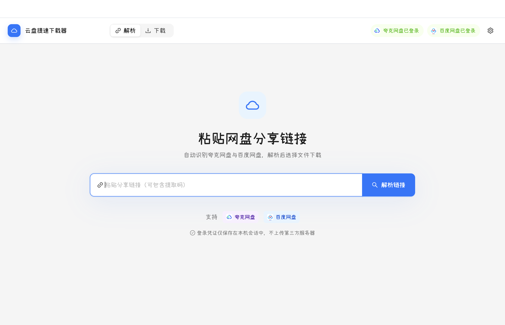
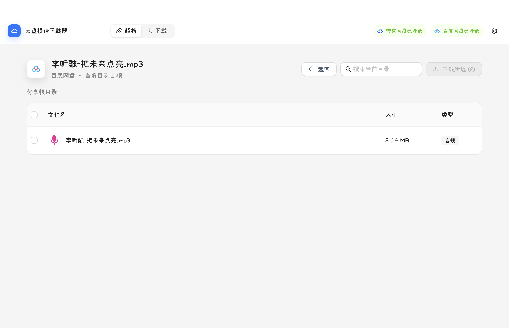

# 云盘提速下载器

云盘提速下载器是一款面向 macOS 和 Windows 的桌面端网盘分享解析与下载工具。粘贴夸克网盘或百度网盘分享链接后，即可浏览目录、跨目录选择文件，并使用本地下载队列统一管理任务。

项目基于 Electron、React、TypeScript、electron-vite 和 Ant Design 构建，支持独立持久登录会话、链接内提取码识别、多任务并发、断点续传、暂停/继续、下载历史与自定义下载目录。

| 分享链接解析                                     | 文件浏览与选择                                       |
| ------------------------------------------------ | ---------------------------------------------------- |
|  |  |

> 这个项目不会破解会员、绕过账号权限、验证码或平台风控。所谓“减少客户端限速影响”的实现边界，是在平台已向当前账号返回合法下载直链后，由桌面端用 HTTP Range 和任务并发下载；实际速度仍取决于网盘服务端对账号和链接的限制。

## 启动

```bash
npm install
npm run dev
```

类型检查与生产构建：

```bash
npm run typecheck
npm run build
```

打包：

打包命令与 `codex-switcher` 保持同一风格，构建时不会自动发布：

```bash
npm run dist:mac
npm run dist:win
```

`package:mac` / `package:win` 仍作为兼容别名保留。electron-builder 配置集中在
`electron-builder.yml`，Windows 同时生成 NSIS 安装包和 portable 版本。

Windows 包应在 Windows 或配置了 Wine/交叉打包环境的构建机上生成。正式分发前还需要配置 macOS Developer ID / notarization 与 Windows 代码签名。

## 使用流程

1. 在主界面登录对应网盘。登录页使用独立的 Electron 持久 Session，Cookie 不进入 React 页面和 localStorage。点击顶部已登录的账号标签可退出该网盘账号，并清除对应的本地会话。
2. 粘贴分享链接，必要时填写提取码，点击“解析链接”。
3. 点击文件夹逐层浏览，勾选文件后下载。夸克分享文件优先直接获取下载地址；仅当接口返回 `23018 / download file size limit` 时，检查个人网盘剩余空间，将所选文件转存到夸克默认分享目录，再获取下载地址。百度分享文件通过分享下载接口获取地址。
4. 下载页可查看来源标签、暂停、继续、取消，已完成任务可打开所在目录。未完成文件以 `.part` 保存，继续时使用 Range 请求；完成前会核对文件大小。

夸克账号状态由 `pan.quark.cn/account/info` 验证，下载令牌接口的错误不再被解释为“未登录”或“账号封禁”。夸克 API 请求明确使用 `credentials: 'include'` 携带持久会话 Cookie。此前同一 146.94 MB 文件在缺少此设置时返回 `23018`；补上后，原始分享文件直链返回成功，实际下载并校验了完整的 154,078,963 字节，无需转存。历史任务的分享凭证过期时会刷新后重试。

若携带登录凭证后直链接口仍返回 `23018`，转存流程只处理当前选中的单个文件；剩余空间不足或容量无法确认时不执行转存。转存文件保留在个人网盘的默认分享目录，不会自动删除，因此会占用个人网盘空间。下载任务会显示“已转存”标签，续传时复用该文件。该回退流程已用实际账号验证能完成转存并获取个人网盘文件地址；验证产生的副本已清理。

## 代码结构

- `src/main/providers/`：provider 注册表、持久会话和各平台适配器。新增平台时实现
  `CloudProviderAdapter` 并注册，不需要修改 UI 的解析流程。
- `src/renderer/src/components/`：页面与交互组件，优先使用 Ant Design。
- `src/renderer/src/hooks/useCloudPan.ts`：解析、登录、选择和下载任务的页面状态。
- `src/shared/types.ts`：主进程、preload 和 renderer 共用的收窄类型契约。

提交前可执行：

```bash
npm run format
npm run typecheck
npm run build
```

## 设计与参考

Provider 层参考了以下开源项目所验证过的平台边界，但没有复制其代码：

- [OpenList](https://github.com/OpenListTeam/OpenList)：多网盘 driver 分层、登录态与下载链接分离。
- [Alist](https://github.com/alist-org/alist)：网盘适配器与统一文件模型。
- [BaiduPCS-Go](https://github.com/qjfoidnh/BaiduPCS-Go)：百度网盘登录态与下载请求头思路。
- [Quark Share Downloader](https://github.com/larryisthere/quark-share-downloader)：参考其用分享文件 ID 和 `share_fid_token` 直接请求夸克下载地址的流程；没有复制其代码。
- [LinkSwift](https://github.com/hmjz100/LinkSwift)：参考其夸克桌面端下载请求参数及 `23018` 错误处理；没有复制其代码。
- [netdisk-fast-download](https://github.com/qaiu/netdisk-fast-download)：其夸克实现将 `23018` 识别为分享直链大小限制，并转存后获取个人网盘文件地址；本项目仅在该错误下使用转存。
- [quarkdownloaderpro](https://github.com/OP404OP/quarkdownloaderpro)：参考其通过 `/account/info` 区分账号登录状态与下载接口状态的做法。
- [Motrix](https://github.com/agalwood/Motrix)：桌面下载任务队列与 aria2 风格交互。
- [CloudSaver](https://github.com/jiangrui1994/CloudSaver)：夸克分享的 `stoken`、
  `share_fid_token` 与目录字段结构。本项目仅参考公开接口边界与字段含义，
  没有复制其业务代码。

网盘私有接口可能随时变化。`src/main/providers.ts` 把平台差异集中在适配器内；生产维护时应补充真实账号下的集成测试，并遵守平台服务条款。

## 安全边界

- `contextIsolation: true`、`sandbox: true`、`nodeIntegration: false`。
- 只允许 `https:` 且属于对应平台域名的下载地址。
- 文件名经过清理，最终路径固定在用户选择的目录下。
- 网盘凭证保存在 `persist:cloudpan-quark` / `persist:cloudpan-baidu` 会话中。
- Renderer 只能通过收窄的 preload API 调用主进程。
