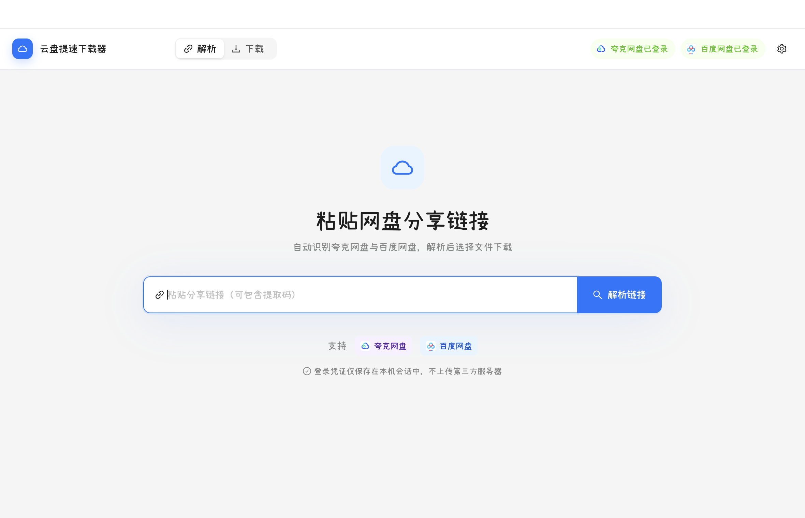
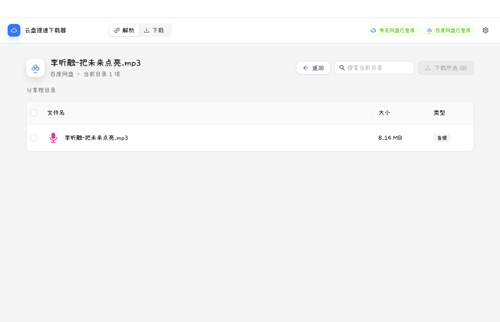

# 云盘提速下载器

云盘提速下载器是一款面向 macOS 和 Windows 的桌面端网盘分享解析与下载工具。粘贴夸克网盘或百度网盘分享链接后，即可浏览目录、跨目录选择文件，并使用本地下载队列统一管理任务。

项目基于 Electron、React、TypeScript、electron-vite 和 Ant Design 构建，支持独立持久登录会话、链接内提取码识别、多任务并发、断点续传、暂停/继续、下载历史与自定义下载目录。

| 分享链接解析                                     | 文件浏览与选择                                       |
| ------------------------------------------------ | ---------------------------------------------------- |
|  |  |

> 这个项目不会破解会员、绕过账号权限、验证码或平台风控。所谓“减少客户端限速影响”的实现边界，是在平台已向当前账号返回合法下载直链后，由桌面端用 HTTP Range 和任务并发下载；实际速度仍取决于网盘服务端对账号和链接的限制。

## 启动

```bash
npm install
npm run dev
```

类型检查与生产构建：

```bash
npm run typecheck
npm run build
```

打包和发布（与 HLOLT 用法一致）：

```bash
# 构建当前平台安装包，不上传
make pc

# 构建当前平台安装包，并上传 GitHub Release
make pc:release
```

macOS 使用当前 Node.js 架构（arm64 / x64），Windows 固定构建 x64。
版本读取根目录 `package.json`，产物保存到 `release/<版本>/darwin-<架构>/`
或 `release/<版本>/windows-x64/`。Windows 生成 NSIS 安装包和 portable 版本。
Windows 上需先安装 GNU Make；也可直接运行 `node scripts/build-pc.mjs`
或 `node scripts/build-pc.mjs --release`。

发布前需要安装 GitHub CLI 并执行 `gh auth login`，账号需有
`ihezebin/cloudpan-dl` 仓库的发布权限。发布命令使用 `v<版本>` 标签：不存在时
创建正式 Release，已存在时替换本平台的同名附件，保留其他平台附件。
如果标签尚不存在，GitHub 会在远端默认分支创建标签，因此发布前应先提交并推送
准备发布的代码。命令不会自动提交、推送代码或递增版本号。

原有命令仍可使用，产物继续放在 `release/`：

```bash
npm run dist:mac
npm run dist:win
```

`package:mac` / `package:win` 仍作为兼容别名保留。electron-builder 配置集中在
`electron-builder.yml`。

安装包图标沿用应用内的蓝底白云标识：源文件为 `build/icon.svg`，macOS 使用 `build/icon.icns`，Windows 使用 `build/icon.ico`，Linux 使用 `build/icon.png`。修改图标后需要重新打包并安装。

Windows 包应在 Windows 或配置了 Wine/交叉打包环境的构建机上生成。正式分发前还需要配置 macOS Developer ID / notarization 与 Windows 代码签名。

## 使用流程

1. 在主界面登录对应网盘。登录页使用独立的 Electron 持久 Session，Cookie 不进入 React 页面和 localStorage。点击顶部已登录的账号标签可退出该网盘账号，并清除对应的本地会话。
2. 粘贴分享链接，必要时填写提取码，点击“解析链接”。
3. 点击文件夹逐层浏览，勾选文件后下载。夸克分享文件优先直接获取下载地址；仅当接口返回 `23018 / download file size limit` 时，检查个人网盘剩余空间，将所选文件转存到夸克默认分享目录，再获取下载地址。百度分享文件通过分享下载接口获取地址。
4. 下载页可查看来源标签、暂停、继续、取消，已完成任务可打开所在目录。未完成文件以 `.part` 保存，继续时使用 Range 请求；完成前会核对文件大小。

夸克账号状态由 `pan.quark.cn/account/info` 验证，下载令牌接口的错误不再被解释为“未登录”或“账号封禁”。夸克 API 请求明确使用 `credentials: 'include'` 携带持久会话 Cookie。此前同一 146.94 MB 文件在缺少此设置时返回 `23018`；补上后，原始分享文件直链返回成功，实际下载并校验了完整的 154,078,963 字节，无需转存。历史任务的分享凭证过期时会刷新后重试。

若携带登录凭证后直链接口仍返回 `23018`，转存流程只处理当前选中的单个文件；剩余空间不足或容量无法确认时不执行转存。转存文件保留在个人网盘的默认分享目录，不会自动删除，因此会占用个人网盘空间。下载任务会显示“已转存”标签，续传时复用该文件。该回退流程已用实际账号验证能完成转存并获取个人网盘文件地址；验证产生的副本已清理。

## 文件预览

点击文件行打开预览，复选框用于选择下载；文件夹仍点击进入。文件预览在独立窗口中打开，同一文件再次点击会聚焦已有窗口，提供重新加载和下载入口。预览界面与主应用共用主题色和字体，支持跟随系统，修改设置后会同步到已经打开的预览窗口。加载动画居中覆盖内容区，不挤占播放器布局。

| 类型             | 支持范围                                                                                                         |
| ---------------- | ---------------------------------------------------------------------------------------------------------------- |
| 文本、代码、字幕 | TXT、Markdown、JSON、日志、CSV、常见源码和字幕等；支持 UTF-8、GB18030、UTF-16、Big5 编码切换和复制               |
| 图片             | PNG、JPEG、GIF、WebP、BMP、SVG、AVIF、ICO                                                                        |
| 视频、音频       | 使用 Electron 内置播放器，支持进度拖动、倍速和视频全屏；实际兼容性取决于编码，推荐 H.264/AAC MP4、WebM、MP3、WAV |
| PDF              | 浏览器原生 PDF 阅读器，支持翻页、缩放和搜索                                                                                 |
| Office           | DOCX 正文、XLSX 工作表与缓存值、PPTX 各页文字；内容预览不还原原始排版、图片、图表和动画                          |
| ZIP              | 列出压缩包内的文件名与大小，不解压到磁盘                                                                         |

旧版 DOC/XLS/PPT、RAR/7Z 及其他不支持的格式会提示下载后打开。加密 Office/ZIP 不保证可预览。

预览仍会读取网络数据，受网盘登录状态、访问权限和速度限制影响。媒体按播放器请求流式读取；其余支持的类型需读取文件后展示。文本最多读取前 2 MB；图片、PDF、Office 和 ZIP 上限为 30 MB。Office 解压内容限制 40 MB，ZIP 最多列出 10,000 项，工作表最多显示 1,000 行、100 列（不执行公式，日期等可能显示底层数值）。

百度下载取址签名兼容新版页面的 `/share/tplconfig` 接口，并保留旧页面回退。百度视频预览使用官方分享播放页生成的在线播放凭证和 HLS 流（默认 480p），不依赖受限的下载直链，也不转存。初始化页面始终静音；关闭预览会销毁初始化页面和播放器。预览失败通过右上角 notification 展示具体错误，不使用内嵌 Alert。播放器销毁、重新加载后返回的旧错误会被忽略；视频恢复就绪后会清除失败提示，避免已经播放成功仍显示旧错误。首次播放清单允许等待 75 秒，覆盖百度页面最长 60 秒的初始化；单次请求超时不会取消仍在进行的共享初始化，关闭预览才会终止它。主进程失败阶段会记录到 Electron 日志目录中的 `preview-errors.log`，不记录 Cookie 或签名 URL。

PDF 使用独立浏览器视图打开临时文件，关闭或重新加载时清理临时文件。预览使用独立临时地址，不加入下载队列；关闭预览窗口会取消读取并释放资源。夸克预览遇到必须转存的限制会显示提示，不自动转存。点击预览窗口中的“下载”才会进入现有下载流程。

验证：`npm test` 覆盖分享目录和预览取流逻辑。已使用隔离 Electron 会话和本地样例验证文本、图片、PDF、Office、ZIP、WAV、H.264 MP4 的显示与视频拖动；另已使用登录会话验证 FDE《第 1 章 FDE 的崛起》14 页 PDF 在浏览器阅读器中显示、主题同步和关闭清理，并对真实百度视频进行静音播放、跳转进度和关闭测试；这不代表所有编码、Windows 环境或其他网盘账号下的取流均已验证。

## 代码结构

- `src/main/providers/`：provider 注册表、持久会话和各平台适配器。新增平台时实现
  `CloudProviderAdapter` 并注册，不需要修改 UI 的解析流程。
- `src/renderer/src/components/`：页面与交互组件，优先使用 Ant Design。
- `src/renderer/src/hooks/useCloudPan.ts`：解析、登录、选择和下载任务的页面状态。
- `src/shared/types.ts`：主进程、preload 和 renderer 共用的收窄类型契约。

提交前可执行：

```bash
npm run format
npm run typecheck
npm run build
```

## 设计与参考

Provider 层参考了以下开源项目所验证过的平台边界，但没有复制其代码：

- [OpenList](https://github.com/OpenListTeam/OpenList)：多网盘 driver 分层、登录态与下载链接分离。
- [Alist](https://github.com/alist-org/alist)：网盘适配器与统一文件模型。
- [BaiduPCS-Go](https://github.com/qjfoidnh/BaiduPCS-Go)：百度网盘登录态与下载请求头思路。
- [Quark Share Downloader](https://github.com/larryisthere/quark-share-downloader)：参考其用分享文件 ID 和 `share_fid_token` 直接请求夸克下载地址的流程；没有复制其代码。
- [LinkSwift](https://github.com/hmjz100/LinkSwift)：参考其夸克桌面端下载请求参数及 `23018` 错误处理；没有复制其代码。
- [netdisk-fast-download](https://github.com/qaiu/netdisk-fast-download)：其夸克实现将 `23018` 识别为分享直链大小限制，并转存后获取个人网盘文件地址；本项目仅在该错误下使用转存。
- [quarkdownloaderpro](https://github.com/OP404OP/quarkdownloaderpro)：参考其通过 `/account/info` 区分账号登录状态与下载接口状态的做法。
- [Motrix](https://github.com/agalwood/Motrix)：桌面下载任务队列与 aria2 风格交互。
- [CloudSaver](https://github.com/jiangrui1994/CloudSaver)：夸克分享的 `stoken`、
  `share_fid_token` 与目录字段结构。本项目仅参考公开接口边界与字段含义，
  没有复制其业务代码。

网盘私有接口可能随时变化。`src/main/providers.ts` 把平台差异集中在适配器内；生产维护时应补充真实账号下的集成测试，并遵守平台服务条款。

## 安全边界

- `contextIsolation: true`、`sandbox: true`、`nodeIntegration: false`。
- 只允许 `https:` 且属于对应平台域名的下载地址。
- 文件名经过清理，最终路径固定在用户选择的目录下。
- 网盘凭证保存在 `persist:cloudpan-quark` / `persist:cloudpan-baidu` 会话中。
- Renderer 只能通过收窄的 preload API 调用主进程。
